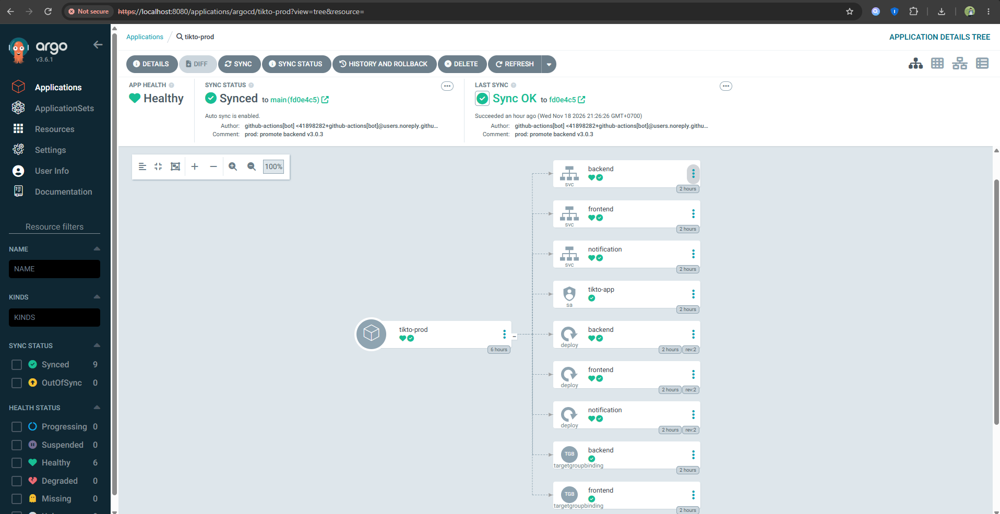
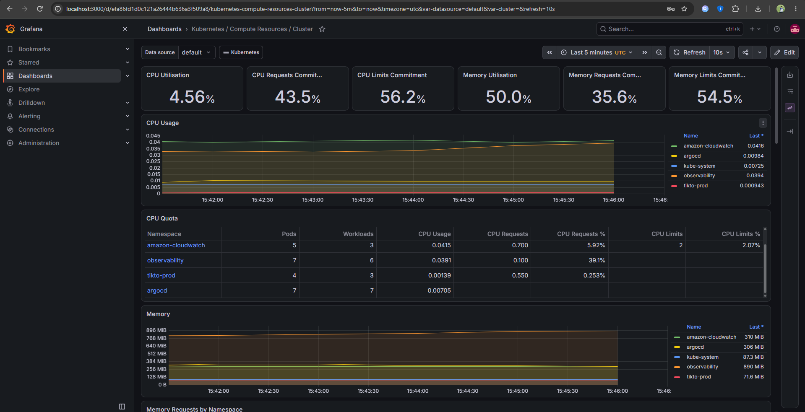

# TikTo Manifest

Defines how Argo CD deploys TikTo Calendar to EKS. The [Helm chart](charts/tikto) uses one Deployment per service and pins each image by its GHCR digest. The Prod Backend Deployment rolls out new images with two replicas.

## Render the chart locally

Install Helm and run these commands from the repository root. Dev renders three Deployments.

**Linux/macOS**

```sh
helm template tikto-dev ./charts/tikto --namespace tikto-dev \
  -f ./charts/tikto/environments/dev/values.yaml \
  -f ./charts/tikto/environments/dev/frontend-image.yaml \
  -f ./charts/tikto/environments/dev/backend-image.yaml \
  -f ./charts/tikto/environments/dev/notification-image.yaml
```

**Windows PowerShell**

```powershell
helm template tikto-dev ./charts/tikto --namespace tikto-dev `
  -f ./charts/tikto/environments/dev/values.yaml `
  -f ./charts/tikto/environments/dev/frontend-image.yaml `
  -f ./charts/tikto/environments/dev/backend-image.yaml `
  -f ./charts/tikto/environments/dev/notification-image.yaml
```

For Prod, use namespace `tikto-prod` and the value files listed in [bootstrap/prod.yaml](bootstrap/prod.yaml).

## Deploy with Argo CD

Set up EKS, Argo CD and AWS Load Balancer Controller using [Terraform](https://github.com/tikto-calender/infra) or [CloudFormation](https://github.com/tikto-calender/infra-by-cloudformation). Confirm kubectl points to that EKS cluster. Run this on **Linux/macOS or Windows PowerShell**.

```sh
kubectl config current-context
kubectl apply -f ./bootstrap/namespaces.yaml
kubectl apply -f ./bootstrap/dev.yaml
kubectl -n argocd get applications
```

If the Prod ALB and target groups are ready, run `kubectl apply -f ./bootstrap/prod.yaml`. Check for `Synced` and `Healthy` in Argo CD and verify `/api/health` at the ALB URL. To enable Telegram, use the [namespace Secret examples](examples/secrets).

## ServiceAccount and AWS access

The Backend ServiceAccount is configured in [chart values](charts/tikto/values.yaml) and rendered by [service-account.yaml](charts/tikto/templates/service-account.yaml):

```yaml
serviceAccount:
  create: true
  name: tikto-app
  annotations: {}
  automountServiceAccountToken: true
```

Each environment gets its own `tikto-app` ServiceAccount in `tikto-dev` or `tikto-prod`. Backend Deployments use this name through the shared [Backend pod template](charts/tikto/templates/_backend.tpl), including the rollout lab. Set `create: false` only when another owner manages the same named ServiceAccount. Frontend and Notification use the namespace's default ServiceAccount with token automount disabled.

AWS permissions are assigned by **EKS Pod Identity**, managed in the infrastructure repositories: [Terraform associations](https://github.com/tikto-calender/infra/blob/main/modules/eks-platform/main.tf) or [CloudFormation associations](https://github.com/tikto-calender/infra-by-cloudformation/blob/main/runtime.yaml). These map each namespace and ServiceAccount to its environment's DynamoDB IAM role. Pod Identity does not require an `eks.amazonaws.com/role-arn` annotation on the Kubernetes ServiceAccount. If changing its name, update the corresponding infrastructure association too. [AWS documentation](https://docs.aws.amazon.com/eks/latest/userguide/pod-id-association.html)

Inspect the ServiceAccounts and the identities used by running Pods:

```bash
kubectl -n tikto-dev get serviceaccount tikto-app -o yaml
kubectl -n tikto-prod get serviceaccount tikto-app -o yaml
kubectl -n tikto-prod get pods \
  -o custom-columns='NAME:.metadata.name,SERVICEACCOUNT:.spec.serviceAccountName'
```

## Install Prometheus and Grafana

Run from the repository root in **WSL / Bash**. The [observability values](observability/values.yaml) declare ServiceAccounts, metrics discovery, retention and resource requests. Keep the release name `monitoring` and namespace `observability` when upgrading the existing installation.

```bash
kubectl config current-context
kubectl get nodes
helm repo add prometheus-community https://prometheus-community.github.io/helm-charts
helm repo update prometheus-community

helm upgrade --install monitoring prometheus-community/kube-prometheus-stack \
  --version 93.4.0 \
  --namespace observability \
  --create-namespace \
  --values ./observability/values.yaml \
  --wait --timeout 10m

kubectl -n observability get pods,serviceaccounts
```

Edit the values file and repeat the command for updates. This configuration uses temporary storage; metrics and Grafana UI changes can be lost when Pods are replaced. See [observability setup](observability/README.md) for passwords, port-forward commands, target checks, ServiceAccount details and recovery from an earlier installation in `default`. Observability is a separate Helm release; it is not part of the `tikto-prod` Argo CD Application.

## Promote to Production

<a name="promote-backend"></a>

After checking Dev, run **Promote Frontend**, **Promote Backend**, **Promote Notification**, or **Promote All Services** from `main` in Manifest's **Actions** tab. The shared workflow tags the verified Dev digest and updates the Prod Helm values for Argo CD. Check the rollout and Prod API, then run **Finalize release** in the source repository with the same version. [Shared workflows](https://github.com/tikto-calender/reusable-workflow)

## Migrate an existing Backend deployment

For a running two-slot installation, finish or cancel the old promotion job and confirm `prod/backend-image.yaml` records the digest serving Prod. Reapply `bootstrap/prod.yaml` after publishing the new chart so Argo CD rolls that digest out to `deployment/backend`.

Wait for the Deployment and its existing Backend target group to become healthy. If the listener still points to Green, switch `/api` to the existing Backend target group before applying the IaC changes. Verify the API, apply IaC to remove the old preview rules and target group, then delete the old Kubernetes resources.

```sh
kubectl -n tikto-prod delete deployment/backend-green service/backend-green targetgroupbinding/backend-green --ignore-not-found
```

## Deployment screenshots

Argo CD: the captured `tikto-prod` Application is `Synced` and `Healthy`, including its `tikto-app` ServiceAccount.



Grafana: the Kubernetes cluster dashboard shows CPU and memory metrics across namespaces, including `tikto-prod` and `observability`.


